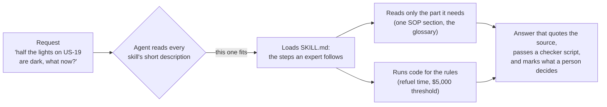

# Transportation Skills

Open agent skills for transportation research and agency practice.

A **skill** is a folder that teaches an AI agent one job the way an experienced engineer
does it: which manual to open, which section to read, which numbers to compute in code
instead of guessing, what to check before answering, and what to leave to a person.

The skills follow the open [Agent Skills format](https://agentskills.io/specification), so
the same folder works in Claude, Claude Code and other agents that support the format
(OpenAI Codex, GitHub Copilot, Gemini CLI, Cursor and more).

This repository started in **CGN 6933 AI for Mobility** at the University of South Florida.
Students, researchers and agency staff are all welcome to contribute.

## How a skill works



The agent reads only the short description of each skill until a request matches. Then it
loads the steps, and opens a reference file or runs a script only when a step calls for it.
That is why one agent can carry many skills without filling its context.

## What makes a skill belong here

Anyone can ask a chatbot to write a SKILL.md about the MUTCD. What it cannot write is the
knowledge: the right edition and section, the threshold that must be computed and not
guessed, the step an SOP leaves out, the call only an engineer should make. That is what
this repository collects, under one rule:

> **Every rule a skill states has a source, and every skill has tests.**

In practice, every skill here has:

1. **Sources** with edition, date and pages, and a note on how it may reuse them.
2. **Rules in code.** Numbers, times and thresholds live in `scripts/`, with tests.
3. **People in charge.** What an agency gives to a person stays with that person.
4. **Evals.** Requests that should and should not load the skill, and tasks run with and
   without the skill.
5. **Limits.** What it does not cover, said plainly.

## Skills

<!-- catalog:start -->
| Skill | What it does | Domain | Status | Version |
|---|---|---|---|---|
| [`d7-signal-sop`](skills/d7-signal-sop/SKILL.md) | Turn the FDOT District 7 Traffic Signals SOP (v1.5, June 2025) into action cards for hurricane response - pre-storm preparation, post-storm signal status from ATMS, gene… | emergency-response | draft | 1.0.0 |
<!-- catalog:end -->

The table is rebuilt automatically after every merge. Want a skill that is not here? See
[SKILLS_WANTED.md](SKILLS_WANTED.md), or propose one with a
[Skill proposal issue](../../issues/new/choose).

## How far to trust a skill

| Status | What it means | Use it for |
|---|---|---|
| `draft` | Passes the checks. Sources, limits, evals and tests are written. | Trying it out and improving it |
| `tested` | Run with and without the skill, 3 times each, graded by hand. Results in `evals/RESULTS.md`. | Research and class work |
| `reviewed` | A practicing professional read it and the results and agreed. Their role, agency and date are recorded. | Agency pilots, with a person still deciding |

## Install a skill

**Claude (claude.ai or the desktop app).** Download the skill's zip from
[Releases](../../releases), then go to Customize > Skills > Upload a skill. Skills with
scripts need code execution turned on. On a Team or Enterprise plan, an owner can add a
skill for everyone.

**Claude Code.**

```
/plugin marketplace add ai4mobility/transportation-skills
/plugin install transportation-skills@ai4mobility
```

**Other agents.** Copy the folder `skills/<name>/` into the folder your agent reads skills
from (see its documentation). Leave `evals/` out: it holds the expected answers.

**Make the zips yourself:** `python tools/package_skills.py` writes `dist/<name>.zip`.

## Contribute

Read [CONTRIBUTING.md](CONTRIBUTING.md), then [docs/WRITING_SKILLS.md](docs/WRITING_SKILLS.md).
The worked example is [`skills/d7-signal-sop`](skills/d7-signal-sop). In short:

```
cp -r template/new-skill skills/<your-skill-name>
# build it, then:
python tools/check_skill.py skills/<your-skill-name>
python -m pytest -q skills/<your-skill-name>/evals
```

Then open one pull request that changes only `skills/<your-skill-name>/`.

Tools that fetch data or drive software (API wrappers, MCP servers) belong in a tools
repository such as [ai4mobility/sumo-agent-tools](https://github.com/ai4mobility/sumo-agent-tools)
or [ai4mobility/WZDx-Tools](https://github.com/ai4mobility/WZDx-Tools). A skill here can use them.

## Please read

These skills are not official products of FDOT, FHWA, NHTSA or any other agency. They help
a qualified person work faster; they do not replace engineering judgment, an engineering
study, or a licensed engineer's decision. Check every output before you act on it.

## License

Code and original text: [MIT](LICENSE). Source documents keep their own terms; each skill's
`## Sources` section says how it reuses them.
